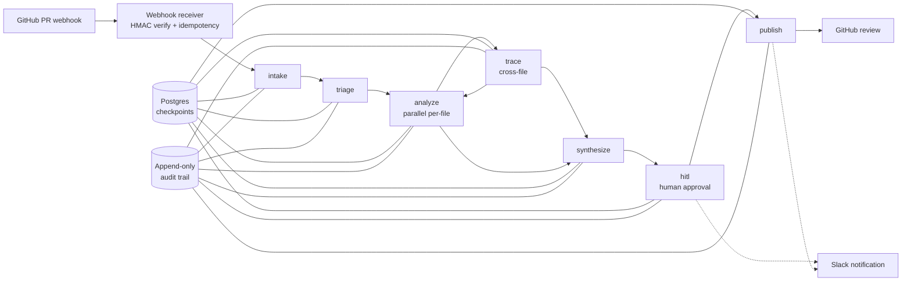

# Outrider

**Get started:** [Production setup](#production-setup) ·
[Follow one review in source](#follow-one-review-in-source) ·
[Seeded read-only demo](https://outrider-review.duckdns.org/#token=demo_0d4890832aa14a0c0b3d64cb38bae952) (keyless, read-only, six seeded reviews)

Outrider reviews GitHub pull requests on your own server. It can post a GitHub review
with inline comments and suggested fixes. It supports Python, JavaScript, TypeScript,
and TSX. Usually, when the code parses without errors, the model sees complete code
sections, such as functions or classes, containing added lines and the matching
parts of the diff.

The model chooses how closely to review each file and proposes issues and fixes.
Outrider assigns severity from a versioned policy, checks the evidence, and chooses
where comments can appear. Critical and high-severity findings require your approval
in the dashboard before they reach GitHub.

The saved review history records completed model exchanges, files examined,
cross-file checks, findings, human decisions, and comment placement. These audit
records are append-only. After each completed production review, a background job
waits briefly for records to finish saving, then checks that the history reconstructs
the expected result. The seven review stages use LangGraph;
[How a review works](#how-a-review-works) walks through them.

You supply your own model API keys. Anthropic is the default; Fireworks and Baseten
also work through their OpenAI-compatible APIs, with GLM-5.2 tested. Beyond GitHub,
source context, diffs, and PR titles go only to your chosen model provider. Optional
Slack notifications contain limited fields; model-written titles may quote short
code fragments. Outrider stores its data in your Postgres database.

You choose how long to keep review, finding, and model-exchange content. Those
settings do not cover audit metadata or LangGraph's saved workflow state
(checkpoints). Outrider does not purge or scrub checkpoints in V1, even when they
share the application database. Set retention controls for that store yourself.

[](https://github.com/ddamme05/Outrider/actions/workflows/ci.yml)

[](LICENSE)

> [!IMPORTANT]
> Outrider is under active development. The core GitHub review workflow is implemented, tested,
> and has driven real pull requests end-to-end on sandbox repositories. It has no production
> users yet, and configuration surfaces and APIs may still change before a stable release. Read
> [What Outrider is not](#what-outrider-is-not) before forming expectations.

## Table of contents

- [Production setup](#production-setup)
  - [Recommended: guided GitHub App setup](#recommended-guided-github-app-setup)
  - [Verify the installation](#verify-the-installation)
  - [Alternative: use an existing GitHub App](#alternative-use-an-existing-github-app)
  - [Optional: Slack notifications](#optional-slack-notifications)
  - [Troubleshooting](#troubleshooting)
- [How a review works](#how-a-review-works)
  - [Follow one review in source](#follow-one-review-in-source)
  - [A file's journey](#a-files-journey)
- [Design guarantees](#design-guarantees)
- [Evaluation](#evaluation)
- [Configuration](#configuration)
- [Security and privacy](#security-and-privacy)
- [What Outrider is not](#what-outrider-is-not)
- [Known limitations](#known-limitations)
- [Development](#development)
- [License](#license)

## Production setup

**Prerequisites:** Git, Docker with Docker Compose, Python 3 (only for the
secret-generation one-liners below), a GitHub account that can create a GitHub App,
an Anthropic API key (or a Fireworks or Baseten key, see `OUTRIDER_LLM_HOST`), and an
HTTPS-reachable public URL for webhooks.

> [!IMPORTANT]
> This guide runs the complete production application using
> `deploy/docker-compose.prod.yml` and `deploy/Dockerfile.prod`.
> `deploy/docker-compose.demo.yml` is only for the seeded read-only demo and
> cannot review pull requests.

Clone the repo and create your env file:

```bash
git clone https://github.com/ddamme05/Outrider.git && cd Outrider
cp .env.example deploy/.env
```

Edit `deploy/.env` (it is fully commented). Minimum for a first boot: `POSTGRES_USER` /
`POSTGRES_PASSWORD` / `POSTGRES_DB`, `ANTHROPIC_API_KEY`, `OUTRIDER_ADMIN_API_KEY` (dashboard
access key, a random secret), and `OUTRIDER_TRUNCATION_HMAC_SECRET` (a random secret, 32+
chars). To use a GLM host instead of Anthropic, set `OUTRIDER_LLM_HOST=fireworks` plus
`FIREWORKS_API_KEY` (or `baseten` plus `BASETEN_API_KEY`) in place of the Anthropic key.

Then add GitHub App credentials. For the recommended guided setup, set these in `deploy/.env`
before launching — in this mode they are required at startup:

```bash
OUTRIDER_GITHUB_CREDENTIAL_SOURCE=database
OUTRIDER_PUBLIC_BASE_URL=https://review.example.com   # bare origin, HTTPS, no path
OUTRIDER_SETUP_STATE_SECRET=<generate-a-random-secret>       # 32+ chars
OUTRIDER_GITHUB_CREDENTIAL_ENC_KEY=<generate-a-key>          # python3 -c "import base64, os; print(base64.urlsafe_b64encode(os.urandom(32)).decode())"
```

Generate every secret independently. Startup checks the setup-state secret against a
[defined list of other Outrider keys](src/outrider/api/setup/state_token.py) and rejects
any match. It also rejects reusing the GitHub credential-encryption key as the Slack
token-encryption key. It does not check every other pair for reuse, so keeping the rest distinct
is on you. To bring your own GitHub App instead, set those variables now — see
[Alternative: use an existing GitHub App](#alternative-use-an-existing-github-app) below.

Next, decide how traffic reaches the app. It serves on `127.0.0.1:8000`, which is loopback only,
so use a reverse proxy or tunnel to make it reachable from GitHub.

<details>
<summary><strong>No static domain? Use an HTTPS tunnel</strong></summary>

Start (or reserve) a tunnel on the same host, such as ngrok, pointed at
`http://127.0.0.1:8000`, and copy its public HTTPS address into `deploy/.env` before
launching (leave off `--profile tls`). Prefer a stable tunnel address. For guided setup,
set `OUTRIDER_PUBLIC_BASE_URL` to that address, with no path. If you use an existing
GitHub App, `OUTRIDER_PUBLIC_BASE_URL` is ignored; set the App's webhook URL to
`<public-url>/webhooks/github` in GitHub instead. Set
`OUTRIDER_DASHBOARD_BASE_URL=<public-url>` if you want working dashboard links.

For Slack, set `OUTRIDER_SLACK_REDIRECT_URI=<public-url>/slack/oauth/callback` and
register that exact URL in the Slack App.

If the tunnel address changes, update `deploy/.env`, recreate the app container, and
update GitHub and Slack to match. For a guided (database-mode) App, update its webhook
URL and Setup URL (`<public-url>/setup`); for an existing (env-mode) App, update its
webhook URL only — Outrider does not mount its onboarding API in that mode, so there is
no Setup URL. Update Slack's redirect URL before a new connection or reconnect. Existing
Slack tokens remain valid, but links in previously posted messages keep their old
address. Redeliver any GitHub events missed during the switch. Do not change the address
during guided GitHub App setup; reset setup and start again. Disable query-string
capture for `/setup/callback` and `/slack/oauth/callback` in the tunnel's request
inspector.

</details>

For automatic HTTPS with the bundled Caddy instead, point your domain's DNS at the server, make
sure inbound ports 80 and 443 are open (Caddy needs both to obtain and renew the certificate), and
set `OUTRIDER_DOMAIN=review.example.com` in `deploy/.env`. If you use your own reverse proxy,
disable or redact query-string logging for `GET /setup/callback` and `GET /slack/oauth/callback`
(both callbacks carry single-use secrets in their query strings, which is also why the production
image runs uvicorn with `--no-access-log`).

Launch the production stack — add `--profile tls` for the bundled Caddy:

```bash
docker compose --env-file deploy/.env -f deploy/docker-compose.prod.yml up -d --build
# with the bundled Caddy (automatic HTTPS on ports 80 and 443):
docker compose --env-file deploy/.env --profile tls -f deploy/docker-compose.prod.yml up -d --build
```

The image builds the dashboard and installs dependencies, a one-shot `migrate` container applies
database migrations before the app starts, and the app serves both the API and the dashboard.
`GET /health` returns `{"status":"ok"}` once the app has booted. This confirms the app is
running; it does not check whether the database or model provider is reachable.

### Recommended: guided GitHub App setup

Outrider creates its own GitHub App for you from an [App Manifest](DECISIONS.md#070-self-service-onboarding-credential-mode--provider--setup-state-machine-refines-066).
Every deployment gets its own App, key, and webhook secret. Outrider does not share an
App across deployments or call a central Outrider service
([#066](DECISIONS.md#066-oss-self-host-via-github-app-manifest--one-app-per-deployment)).

With the stack running and `GET /health` green, open the dashboard's `/setup` page, enter your
GitHub org, and follow the redirect. GitHub creates the App (permissions `contents: read` and
`pull_requests: write`, subscribed to `pull_request` events, webhook pointed at
`{base_url}/webhooks/github`) and redirects back. Outrider verifies the response against what it
requested, encrypts the private key and webhook secret into Postgres, and sends you to GitHub's
install page to pick repositories. The setup link carries a signed, single-use token, so refreshing the
callback URL fails by design.

### Verify the installation

1. Open a pull request in a sandbox repository the App is installed on. The repo ships
   deliberately vulnerable demo fixtures under
   [`scripts/demo_fixtures/`](scripts/demo_fixtures/) (intentional, don't report them), with
   their own README covering the PR procedure, and expected outcomes in
   [`LIVE_RUN_EXPECTED_FINDINGS.md`](LIVE_RUN_EXPECTED_FINDINGS.md).
2. Watch the review appear in the dashboard: webhook received, stages progressing, then status
   `completed`, or `awaiting_approval` if anything critical or high was found.
3. If gated, approve or reject per finding in the dashboard. The review resumes, and it
   posts if at least one eligible or surfaced finding remains (medium and lower severities
   are eligible without approval). If nothing eligible or surfaced remains, publish records
   `no_op_empty` and makes no GitHub call.
4. When a GitHub review is posted, it appears under your App's bot account, with findings
   placed inline on the diff where coordinates allow.

Don't plant a real vulnerability in a repository that matters to test this.

### Alternative: use an existing GitHub App

Create a GitHub App manually (same permissions and events as above, webhook URL
`{your-base-url}/webhooks/github`, a webhook secret you generate). On the App's settings page,
generate and download a private key — GitHub gives you a `.pem` file.

`.env` values do not interpret literal newlines, so the multi-line PEM has to go in as a single
line with escaped `\n` (the format `.env.example` ships). Convert the downloaded key, then set
the three variables:

```bash
# Turn the downloaded .pem into a single escaped line to paste as the value below.
awk 'NF {sub(/\r/, ""); printf "%s\\n", $0}' path/to/your-app.private-key.pem

OUTRIDER_GITHUB_CREDENTIAL_SOURCE=env    # the modes never fall back, so a leftover "database" would ignore these
OUTRIDER_GITHUB_APP_ID=<app id>
OUTRIDER_GITHUB_APP_PRIVATE_KEY="<paste the escaped one-line output, keeping the quotes>"
OUTRIDER_GITHUB_WEBHOOK_SECRET=<your webhook secret>
```

The `OUTRIDER_` prefix is required. A bare `GITHUB_APP_ID` is silently ignored, and so is a
misspelled name inside the prefix, so double-check the three names. A missing required variable
fails at startup with the field named.

Launch the stack as shown above, and once `GET /health` is green, install the App on the
repositories you want reviewed (App settings → Install App → pick repositories). Installing
sends the installation event and subsequent pull-request webhooks immediately, so Outrider
must be running to receive them — GitHub does not retry a delivery that arrives while it is
down.

Then run through [Verify the installation](#verify-the-installation) above to confirm the first
review.

### Optional: Slack notifications

Slack integration is **outbound notifications only**. Each review normally produces one of
two message kinds. A review that pauses for approval gets a card carrying the repository, PR
number and title, severity counts, and up to three gated findings with their severity, type,
file location, and model-written title (an overflow line summarizes the rest). A review that
publishes without gating gets a one-line message carrying the repository, PR number, and
posted versus dashboard-only counts. Descriptions, evidence,
suggested fixes, and source context are not sent to Slack, though model-written
titles may quote short source fragments. Both kinds link to the dashboard when
`OUTRIDER_DASHBOARD_BASE_URL` is set and omit the link otherwise. You cannot trigger reviews
or approve findings from Slack. Delivery and deduplication are best effort. Outrider posts
to Slack before it records the post, so a failure to record can repeat a message after a
resume, and a persistently failing record can let one gated review receive both message
kinds. Configure a Slack app with the `chat:write` scope, set
`OUTRIDER_SLACK_CLIENT_ID`, `OUTRIDER_SLACK_CLIENT_SECRET`, `OUTRIDER_SLACK_REDIRECT_URI`,
`OUTRIDER_SLACK_STATE_SECRET`, and `OUTRIDER_TOKEN_ENC_KEY`, then connect a channel.

The simplest way is the dashboard: open **Connect Slack** in the sidebar, enter the GitHub
installation id and the Slack channel id, and click Connect. That sends you to Slack to
approve the app, Slack redirects back, and the bot token is stored encrypted. This runs only
when the app is serving the built dashboard (the same one-origin requirement as GitHub App
setup), not on the Vite dev server.

If you are setting up Slack without the dashboard, call the same endpoint with curl. It needs your admin bearer
token (export it from `deploy/.env` first, since Production setup only wrote it there), then
fetch the redirect with curl and open the returned Slack URL in a browser:

```bash
export OUTRIDER_ADMIN_API_KEY="$(grep -E '^OUTRIDER_ADMIN_API_KEY=' deploy/.env | cut -d= -f2-)"
curl -si -H "Authorization: Bearer $OUTRIDER_ADMIN_API_KEY" \
  "https://review.example.com/slack/install?installation_id=<github install id>&channel_id=<C0000000000>" \
  | grep -i '^location:'
```

The GitHub installation id is the number at the end of the App's installation settings URL on
GitHub. The Slack channel id starts with `C` (or `G` for private groups) and sits at the
bottom of the channel's details
pane. The redirect URL carries a signed, expiring `state` value containing the
installation and channel ids. The public callback at `GET /slack/oauth/callback` verifies
that state before exchanging the code for a bot token. It takes the installation
and channel identity from the verified state, never from other callback query parameters. After the OAuth install completes,
invite the bot to the channel (`/invite @Outrider`) so posts succeed. Bot tokens are
encrypted at rest. When the Slack variables are unset, Slack is simply off and never blocks
the review pipeline.

### Troubleshooting

> The root `docker-compose.yml` is development database infrastructure only (it has no app
> service). The production stack lives in `deploy/docker-compose.prod.yml`, and the
> `--env-file deploy/.env` flag is required. Without it Compose fails with a misleading
> "set POSTGRES_USER" error.

Until setup completes, the webhook receiver and other credential-dependent routes return 503,
while `/setup`, `/health`, `/privacy`, and the read-only dashboard stay up. GitHub does not
retry failed webhook deliveries on its own, so if a PR event arrived during that window,
redeliver it from the App's settings page (Advanced → Recent Deliveries) once setup finishes.

---

<!-- TODO(screenshots): 1) PR opened → 2) dashboard approval screen → 3) posted GitHub review.
     Use a sandbox repo. Redact installation ids and webhook URLs. -->

## How a review works



A review has seven stages. During analyze, several file reviews can run at once,
so the workflow contains more steps than this stage-level diagram shows.

1. **intake** fetches the PR file list and per-file content from GitHub. No LLM call.
2. **triage** is a fast model pass that assigns each file a deep, standard, or skim tier and
   classifies overall PR risk. Deep and standard files enter the core analyze stage, and skim
   files do not. Oversized pull requests are skipped deterministically during intake, before
   triage runs.
3. **analyze** reviews each selected file. When code parses without errors,
   tree-sitter, a code parser, usually selects the code sections containing added lines.
   Deep-tier files go to the stronger model and standard-tier files to the cheaper
   one. Outrider checks the token budget before each call.
   That split is the Anthropic default, and a GLM host serves both tiers with one model. A
   deterministic catalog of 19 tree-sitter structural checks (Python and JS/TS, mostly
   security plus reliability patterns) contributes findings alongside the model's.
4. **trace** checks code outside the diff when a finding may depend on it. It ranks
   possible imports, checks their repository paths, and tries to locate each file
   through GitHub. A file returns to analyze only when its location is unambiguous,
   it is outside the diff, it has not been fetched already, and the fetch budget
   allows it. The fetched content must be usable text, and trace depth is limited.
5. **synthesize** combines findings from all rounds, removes duplicates, orders them
   by severity, and generates a limited number of fix suggestions for eligible findings.
6. **hitl** is the human gate. If any finding is critical or high severity, the graph
   pauses and saves its state. A human approves, rejects, overrides severity, or
   suppresses each finding from the dashboard. By default nothing critical or high reaches
   GitHub without that decision, ever. The timeout action is `expire_only`, not auto-post.
7. **publish** posts one GitHub review when at least one eligible or surfaced finding
   remains, and otherwise records `no_op_empty` and makes no GitHub call. Each finding routes
   to an inline comment, the review body, or dashboard-only, based on whether its
   code location maps to a line GitHub can accept. Outrider computes that location;
   the model cannot choose it.

Outrider saves workflow state to Postgres at each step. A review paused for approval
can survive an application restart and resume afterward.

### Follow one review in source

After [installing the GitHub App](#production-setup), open a non-draft PR, push a commit,
reopen the PR, or mark a draft ready for review. GitHub sends the event to Outrider.
One review follows one PR head commit: a new commit gets a new review ID; another delivery
for the same repository, PR and commit reuses the existing review.

Read these entry points in order, following the same `review_id`:

| Step | What happens | Start reading here |
|---|---|---|
| 1. Receive the PR | Verify the webhook, check eligibility, save the review, and return its ID. | [`receive_pull_request_webhook`](src/outrider/api/webhooks/router.py) |
| 2. Start work | Queue background execution; the runner created at startup uses the review ID to find its saved workflow state. | [`BackgroundTasksDispatcher.dispatch`](src/outrider/dispatcher/background_tasks.py), `run_graph` in [lifespan.py](src/outrider/api/lifespan.py) |
| 3. Review code | Fetch files, choose review depth, analyze, optionally trace other files, and assemble findings. | [`build_graph`](src/outrider/agent/graph.py), then the named functions in [agent/nodes](src/outrider/agent/nodes/) |
| 4. See progress | The dashboard reads stored status, findings, and audit history through the API. | [`ReviewDetail`](dashboard/src/routes/ReviewDetail.tsx), [dashboard read endpoints](src/outrider/api/dashboard/reviews.py) |
| 5. Make a decision | High/critical findings pause the workflow. Dashboard decisions resume the saved review. | [`hitl`](src/outrider/agent/nodes/hitl.py), [`decide`](src/outrider/api/dashboard/hitl.py) |
| 6. Post to GitHub | Apply decisions and publication rules, choose comment locations, and submit a comment review when there is material to publish. | [`publish`](src/outrider/agent/nodes/publish.py), [`GitHubKitPublisher.create_review`](src/outrider/github/publisher.py) |
| 7. Inspect the outcome | Show findings, their destinations, and recorded execution; replay plays stored history. | [`FindingCard`](dashboard/src/components/FindingCard.tsx), [`ReplayFeed`](dashboard/src/components/ReplayFeed.tsx), [`ReplayReconstruct`](dashboard/src/routes/ReplayReconstruct.tsx) |

Within analysis, [analyze.py](src/outrider/agent/nodes/analyze.py) coordinates each file.
Follow [analyze_observed.py](src/outrider/agent/nodes/analyze_observed.py) for evidence from
local code queries and [analyze_parser.py](src/outrider/agent/nodes/analyze_parser.py) for
checking model proposals, then return to the coordinator for cost, audit and cache handling.

To walk through a real example, open `/reviews`, select one review, and follow one finding
from its evidence to its decision and publication destination. The review page polls status
and audit progress every two seconds; refresh to reload finding details after publication.
The replay page inspects saved work and makes no new model or GitHub calls.

For the browser side, follow the [dashboard source walkthrough](dashboard/README.md)
from startup and authentication to pages, shared components, and approval submission.

`completed` means processing finished. Check the publication outcome separately: an empty
result makes no GitHub call, and some findings remain dashboard-only. Published reviews use
GitHub's `COMMENT` event; dashboard approval controls what Outrider posts.

### A file's journey

What stays local and what reaches the model, stage by stage:

```mermaid
flowchart TD
    GH["GitHub pull request webhook"] --> IN["Intake"]

    IN --> FETCH["Validate paths and limits<br/>fetch patch and complete eligible content<br/>at the exact base and head SHAs"]
    FETCH --> CP[("Postgres checkpoint<br/>patch plus fetched file content")]

    FETCH -->|"PR title, file metadata, and patch"| TR["Triage model"]
    TR --> TIER{"File tier"}

    TIER -->|"skim"| SKIM["Excluded before analyze<br/>(recorded in checkpointed<br/>triage state)"]
    TIER -->|"deep or standard"| LANG{"Language supported?"}
    LANG -->|"no"| ASKIP["Audited analyze skip<br/>(per-file examination event)"]
    LANG -->|"yes"| TS["Tree-sitter parses<br/>the complete file locally"]

    TS --> OUT{"Parser and<br/>degradation outcome"}
    OUT -->|"clean scopes"| SELECT["Select scopes containing added lines<br/>run structural checks locally"]
    OUT -->|"parse errors in changed regions"| DEG["Degraded path<br/>(model proposals admit as judged)"]
    OUT -->|"vendored, oversized, or no changed scopes<br/>and no eligible module-level match"| ASKIP
    SELECT --> BUD{"Pre-flight budget<br/>admits the call?"}
    DEG --> BUD
    BUD -->|"scope bodies or bounded hunks,<br/>clipped hunks, fired query IDs"| AN["Analyze model"]
    BUD -->|"exhausted: audited skip<br/>(deterministic structural findings<br/>can still land)"| ASKIP

    AN --> ADMIT["Validate proposals<br/>apply deterministic severity<br/>and coordinate gates"]

    ADMIT --> ROUND{"Initial analyze pass?"}
    ROUND -->|"yes"| CAND{"Admitted finding has<br/>trace candidates?"}
    ROUND -->|"no: post-trace pass"| SYN
    CAND -->|"yes: candidate identifiers,<br/>import strings, and reasons"| RANKQ{"Within-finding ordering<br/>nontrivial?"}
    RANKQ -->|"yes"| RANK["Trace ranking model"]
    RANKQ -->|"no, deterministic order"| RESOLVE["Derive and validate candidate paths<br/>run bounded GitHub fetch probes"]
    RANK --> RESOLVE
    RESOLVE -->|"uniquely resolved"| P2{"Eligible? outside the diff,<br/>not already fetched,<br/>budget left"}
    P2 -->|"yes"| FET["Fetch attempt"]
    P2 -->|"no: no new file"| SYN
    FET -->|"usable content"| RELATED["Parse the resolved<br/>related file locally"]
    FET -->|"404 or unusable content:<br/>no new file"| SYN
    FET -->|"other fetch failure"| ERR["Review run fails<br/>(no partial trace)"]
    RESOLVE -->|"unresolved or ambiguous:<br/>no fetch, logged decision"| SYN
    RESOLVE -->|"other fetch failure"| ERR
    RELATED --> PTGATE{"Supported language,<br/>parse yields reviewable scopes?"}
    PTGATE -->|"no: audited skip,<br/>no model call"| SYN
    PTGATE -->|"yes"| PTBUD{"Post-trace prompt<br/>within budget?"}
    PTBUD -->|"no: audited skip,<br/>no model call"| SYN
    PTBUD -->|"yes: error-free scope bodies<br/>plus the originating finding"| POST["Post-trace analyze model"]
    POST --> ADMIT

    CAND -->|"no"| SYN["Synthesis and fix calls<br/>(finding text and metadata, risk, metrics;<br/>one target line per fix)"]
    SYN --> HITL["Human approval when required"]
    HITL --> PUB["Publish eligible findings to GitHub"]

    HITL -.-> SL["Slack notification<br/>limited fields only"]
    PUB -.-> SL
```

<details>
<summary>Detailed file and model-data flow</summary>



</details>

Intake fetches complete eligible file content (bounded per file and per review) because
tree-sitter parsing, the structural checks, coordinate validation, and suggested-fix anchoring
all need the authoritative source. For modified and renamed files, both the base and head
versions are retained in review state.

When code parses without errors, Outrider usually selects the code sections
containing added lines and sends their complete bodies with the matching diff
sections. The model sees
the surrounding logic without unrelated parts of the file.

If changed code cannot be parsed, Outrider sends only size-limited diff sections.
Findings from that path count as model judgment, without structural proof.
Selecting code sections also lets Outrider check proposed finding locations against
the sections it sent. Nested sections can overlap and duplicate code; the token
budget accounts for that. Whether this lowers cost or improves quality compared
with sending whole files still needs measurement.

When a finding may depend on another file, trace checks possible repository paths
through GitHub. Outrider fetches and parses a file for further analysis only if
it resolves to one location, is outside the diff, has not been fetched already,
and fits the budget.
A follow-up analyze pass reviews its code sections that parsed without errors.
A missing file produces a recorded decision. A connection failure stops the trace pass.

## Design guarantees

These rules govern findings and publication. The linked entries in
[DECISIONS.md](DECISIONS.md) explain why each rule exists:

| Guarantee | Mechanism |
|---|---|
| Outrider assigns severity | The model chooses one of 22 `FindingType` values. A versioned policy table sets severity. Model responses cannot supply a severity field (`extra="forbid"`), the table cannot change at runtime, and past reviews use their original policy version during replay. |
| Evidence claims need supporting records | Every finding has an evidence tier: `observed` (a structural check matched, with its query id), `inferred` (a recorded trace path), or `judged` (model judgment). An observed finding must supply an id. Analyze checks that the referenced query ran and matched; replay checks that the query exists in the registry. |
| High-risk findings require a human | Critical and high findings pause the saved review. It resumes only after an explicit decision for each finding (dashboard `POST /reviews/{id}/decide`). A timed-out approval expires without posting. |
| Saved history can reconstruct a review | The `audit_events` table is append-only: database triggers block UPDATE and DELETE, checked by an integration test. A background job replays each eligible completed production review; evaluation runs are excluded. It checks event structure, evidence references, and content hashes. Running stored queries again against the evidence is planned work. |
| External libraries stay in specific modules | `anthropic` and `openai` import only under `llm/`, `githubkit` under `github/` and the webhook receiver, `tree_sitter` under `ast_facts/` and the query catalog (`queries/`), `slack_sdk` under `notify/`. CI checks those import locations ([#038](DECISIONS.md#038-the-cipre-commit-import-lint-is-the-deterministic-trust-boundary-floor-fup-005), [`scripts/check_import_boundaries.py`](scripts/check_import_boundaries.py)). Reviewing or replacing a library stays within a few modules. |

## Evaluation

The tables below come from result files stored in this repository. You can
recompute every number from their JSON.

### Cross-provider baseline (tracked artifact)

[`tests/eval/baselines/analyze-exemplars/analyze-v10+suite-v2.json`](tests/eval/baselines/analyze-exemplars/analyze-v10+suite-v2.json)
records 288 model calls: three configurations (two Anthropic tiers plus GLM on
Fireworks) × 32 test cases (22 with planted vulnerabilities and 10 safe) × 3 repetitions.
A finding counts as detected when it appears in at least two of the three runs.
This baseline was frozen on 2026-07-15, before testing future prompt changes.
The comparison checks the analyze prompt version and a content hash of its shared
system instructions. That hash does not yet cover the user-side message templates;
adding them is tracked follow-up work.

| Model configuration (as recorded) | Vulnerable fixtures detected | Safe fixtures wrongly flagged | Structured outputs accepted |
|---|---:|---:|---:|
| `claude-sonnet-5` (deep tier) | 22 / 22 | 3 / 10 | 96 / 96 |
| `claude-haiku-4-5` (standard tier) | 21 / 22 | 6 / 10 | 96 / 96 |
| `accounts/fireworks/models/glm-5p2` | 18 / 22 | 0 / 10 | 96 / 96 |

Recorded with prompt `analyze-v10` (content digest `4520a0062443…`), fixture suite `suite-v2`,
measurement contract `exemplar-mc-2`, artifact schema v4. Frozen in commit `0d75028`. A later
commit (`e467626`) corrected one line of schema-version metadata, with every measured value
byte-identical. For each provider and finding type, a prompt change must find at least as many
real issues, flag no more safe cases, and produce no more extra findings per test
case. The check also requires both the prompt version and its content hash to change.

> These are results from controlled test cases. They do not measure production
> performance or establish a statistical ranking of models. Three runs can show
> differences in this sample, but cannot rank the models in general.

### Prompt-cache measurement (same artifact)

Input token counts for the 96 Sonnet calls in the baseline above:

```text
cache-read      1,033,030
cache-write        10,874
ordinary input     41,358
total           1,085,262   →  95.2% served from cache (Haiku: 94.8%)
```

The test ran calls one after another. These percentages measure cached input in
that test, not production cache use or cost. GLM/Fireworks reached 66.7% in the same
runner. Our probes found no consistent cache reuse between requests, which suggests
caches belong to individual server replicas. Parallel production calls likely reuse less.

### Structured-output reliability (tracked artifact)

[`tests/eval/baselines/glm-yield/analyze-v10-glm-yield.json`](tests/eval/baselines/glm-yield/analyze-v10-glm-yield.json)
records a separate test on two hosts: 60/60 outputs accepted on Fireworks and 60/60
on Baseten, zero rejected and zero provider errors, with the raw counts saved. Combined with the baseline's 288/288, no
structured output was rejected in 408 recorded calls across three hosts.

### False-positive calibration (internally measured)

Early prompts often produced a finding even for clean code. Fixing one wrong label
led to a different wrong label on the same code. A shared rule that an empty findings
list is a valid, common result cut false positives 28 → 5 across finding types,
without missing any more real issues. The
probe: 3 prompt variants × 2 Claude models × 11 fixtures × 5 repetitions, 330 runs in all.

The rule ships in the production prompt and its exact wording is
pinned by a unit test ([`tests/unit/test_prompts_analyze.py`](tests/unit/test_prompts_analyze.py)),
but the raw probe artifact is not yet published in this repository. Treat 28 → 5 as an
internally measured result, unlike the tables above, which are recomputable from tracked JSON.

### The offline tiers

The structural evaluation tests (currently 186, collected by
`uv run pytest tests/eval/scenarios/structural --is-eval`) check code parsing and
comment-location translation with no model calls or network access. Every paid test
case first goes through the real analyze checks offline. Cases that would be skipped
or rejected do not reach a paid run.

## Configuration

[`.env.example`](.env.example) is the complete, commented reference for every variable. The
most-used settings:

| Variable | Required | Default | Purpose |
|---|---|---|---|
| `DATABASE_URL` | yes (the prod compose derives it) | none | Postgres, `postgresql+psycopg://` scheme enforced |
| `CHECKPOINT_DATABASE_URL` | no | falls back to `DATABASE_URL` | separate LangGraph checkpoint store. Contains review content; Outrider does not delete it in V1 (shared or split), so set your own retention controls |
| `OUTRIDER_ADMIN_API_KEY` | yes | none | dashboard and approval-endpoint bearer token |
| `OUTRIDER_TRUNCATION_HMAC_SECRET` | yes | none | authenticates truncation markers in sanitized output |
| `ANTHROPIC_API_KEY` | with the default host | none | LLM provider key |
| `OUTRIDER_LLM_HOST` | no | `anthropic` | `anthropic`, `fireworks`, or `baseten` ([#056](DECISIONS.md#056-openai-compatible-providers-via-a-host-qualified-hostprofile-registry)) |
| `OUTRIDER_MODEL_ANALYZE_MODEL` | no | `claude-sonnet-5` | deep-tier analyze model |
| `OUTRIDER_MODEL_STANDARD_ANALYZE_MODEL` | no | `claude-haiku-4-5` | standard-tier analyze model |
| `OUTRIDER_ANALYZE_REVIEW_BUDGET_TOKENS` | no | `200000` | pre-flight per-review token budget |
| `OUTRIDER_MAX_CONCURRENT_REVIEWS` | no | `8` | per-process concurrent-review cap |
| `OUTRIDER_HITL_TIMEOUT_ACTION` | no | `expire_only` | what happens when approval times out. The default never auto-posts |
| `OUTRIDER_AUDIT_LLM_CONTENT_RETENTION_TTL` | no | `P90D` | How long to keep model-exchange content, as an ISO-8601 duration. Separate settings cover findings and reviews |
| `OUTRIDER_PATCHES_ENABLED` | no | `true` | suggested-fix patches, bounded by `OUTRIDER_MAX_PATCH_SUGGESTIONS_PER_REVIEW` (default 5) |
| `OUTRIDER_ENABLE_DOCS` | no | off | opt-in `/docs` and `/openapi.json`, off in production by default |

A few configuration details: `.env` values don't interpolate, so if you change
`POSTGRES_PASSWORD` you must also update the password inside `DATABASE_URL` (the prod compose
stack handles this for you). Retention TTLs parse as ISO-8601 durations (`P90D`, `PT24H`), not
integer seconds. A few variables documented near the end of `.env.example` are marked as not
yet read by any code.

## Security and privacy

**What leaves your infrastructure.** The full privacy statement below describes
what Outrider sends and stores. Its terms are recorded in
[#015](DECISIONS.md#015-zdr-is-an-operator-attestation-not-a-runtime-opt-in) and
[#016](DECISIONS.md#016-llm-exchanges-stored-locally-under-retention-logs-stay-metadata-only).

<!-- Privacy wording is fixed by #015/#016. Changes require a superseding decision. -->

<details>
<summary>Read the full privacy statement</summary>

> Outrider sends data to the configured LLM provider only through its review-stage model calls. Depending on the stage, this includes: the PR title, changed-file paths and metadata, diff patches, complete bodies of scopes containing added lines (or bounded diff hunks on degraded paths), structural query identifiers, trace candidate identifiers, import strings, and reasons, scope bodies from uniquely resolved related files, finding identifiers, metadata, titles, descriptions, and evidence, target source lines used for suggested fixes, and the risk classification and metrics used to generate the final summary. Outrider does not currently send the PR body, author login, commit messages, or branch names; adding any of these requires a new privacy-contract amendment.
>
> Complete eligible file content is fetched and checkpointed locally. Outrider does not send the separately fetched base and head file blobs as whole-file payloads during normal analysis, but GitHub diff patches may contain most or all of an added or heavily rewritten file.
>
> Under Anthropic's default terms, API inputs and outputs are deleted within 30 days, though retention can extend under contractual arrangements, Usage Policy enforcement, or legal requirements; content flagged for policy violations is retained up to 2 years, classification scores up to 7 years; no data is used for training without permission.
>
> If your organization has a ZDR arrangement with Anthropic, set `ANTHROPIC_ZDR_ENABLED=true` — Outrider uses the flag to adjust its startup notice and privacy statement; it does not enable ZDR on its own. Contact Anthropic sales if you need to arrange ZDR. Outrider does not currently support HIPAA-subject workloads.
>
> Outrider stores LLM request and response content in your local database under configured retention TTL (default values in operator configuration; purged on `installation.deleted` along with reviews and findings, per [#012](DECISIONS.md#012-data-retention-ttls-configurable-purge-on-installationdeleted) + [#014](DECISIONS.md#014-audit-events-are-metadata-only-content-purge-targets-reviews-and-findings)). Outrider does not transmit stored LLM content to any third party other than the configured LLM provider at request time per #013/#015's egress rules.

</details>

The pinned statement covers the default Anthropic host. Outrider sends the
same listed data to every host. What changes with `OUTRIDER_LLM_HOST` is who receives the data and whose
terms govern its handling after receipt: see
[Fireworks](https://docs.fireworks.ai/guides/security_compliance/data_handling) and
[Baseten](https://docs.baseten.co/observability/security).

Application logs record metadata, such as IDs and counts. Model requests and responses
stay in the database and never appear in application logs.
Slack, when enabled, receives finding titles, types, severities, file locations, and
dashboard links. Descriptions, evidence, suggested fixes, and source context never go to
Slack (titles are model-written, so treat them as potentially quoting short fragments).

**Checking incoming data.** Outrider verifies webhook signatures with `hmac.compare_digest`.
It checks the expected payload fields before processing them; extra GitHub fields
are allowed so GitHub can add fields without breaking the receiver. It validates
file paths before using them with the filesystem or an API. There is no shell
execution with GitHub-sourced strings anywhere in the
application source tree (`src/outrider/`, CI-enforced). The deliberately vulnerable demo
fixtures under `scripts/demo_fixtures/` are the documented exception in the wider repo.
GitHub App credentials stored by guided setup and Slack tokens are encrypted before
they are written to Postgres, and the App-setup callback carries single-use signed
state. With an existing App, credentials live in your environment file; protect that file.
Outrider does not include its own operator credentials (GitHub App private key, webhook
secret, installation tokens, Slack tokens) in model prompts. It
does not secret-scan repository content before review, so secrets accidentally
committed inside reviewed code can appear in patches and scope text like any other code.

**Reporting.** See [SECURITY.md](SECURITY.md). Please report suspected vulnerabilities
privately, not in a public issue. Outrider has **not** been independently audited or
penetration tested.

## What Outrider is not

- Keep human code review. Outrider can miss defects.
- You run it on your infrastructure, with your provider keys
  ([#011](DECISIONS.md#011-self-hosted-is-canonical-v1-saas-is-v15)).
- There are no production deployments or users yet. Live tests have used
  author-controlled sandbox repositories with planted vulnerabilities.
- The benchmark results above are controlled-fixture measurements, not production precision or
  recall.
- Slack sends notifications and dashboard links. It cannot start reviews or accept approvals.
- Reviews post as PR reviews. There is no GitHub Checks integration.
- Outrider has not had an independent security audit. It has no service-level
  guarantee and is unsuitable for HIPAA-subject workloads.
- It does not train models on your code. Raw source context, diff patches, and the PR title
  go only to your configured model provider. Review output posts back to GitHub, and Slack (when
  enabled) receives only the limited notification fields described above (model-written titles
  may quote short fragments).

## Known limitations

- **Latency is unmeasured.** Instrumentation exists, but there is no published figure yet.
- **Cost per review at full coverage is unmeasured.** Internal sandbox runs (not a tracked
  artifact) came in around $0.10 to $0.12, but they ran under a token budget that skipped
  files. Treat any composed full-coverage figure as a model, not a measurement.
- **Python changes outside functions and classes can escape model review.** A diff
  touching only imports or
  module constants is skipped unless a structural query matches, so a hardcoded secret added in
  a constants-only diff is not reviewed today. This gap is tracked and was found by our
  evaluation tests.
- **Deletion-only changes can escape model review.** Code sections are selected by added lines. An
  otherwise reviewable file whose diff contains only deletions can receive no analyze call at
  all, and in a mixed file a deletion-only scope can be omitted even while another scope gets
  the file reviewed. Deleting an authorization check is one
  example. This is related to the gap for code outside functions and classes.
- **Two cost optimizations only measure by default** (a filter for trivial code
  sections and an analyze cache keyed by file content). They record what they would
  skip or reuse without changing the review. No savings are claimed.
- **Prompts are tuned against Claude models only.** Prompt calibration was performed against
  Sonnet and Haiku. GLM runs the same prefix and holds its own baseline column above, but no
  GLM-specific calibration experiment has been run.
- **Structural analysis covers Python and JS/TS/TSX.** Files in other languages are skipped
  during analyze with an audited `UNSUPPORTED_LANGUAGE` event and do not receive model review
  today.
- **Replay verifies structure and hashes.** Re-executing tree-sitter queries against stored
  evidence spans is future scope.

## Development

```bash
uv sync --dev
.venv/bin/pre-commit install --install-hooks
cp .env.example .env                        # fill POSTGRES_* and TEST_POSTGRES_* for the DB containers
docker compose up -d postgres-test          # isolated tmpfs Postgres for the test tiers (port 5433)
export TEST_DATABASE_URL="$(grep -E '^TEST_DATABASE_URL=' .env | cut -d= -f2-)"
uv run pytest tests/unit                    # fast, no DB, needs no env
uv run pytest tests/integration             # real Postgres, mocked externals
uv run pytest tests/eval --is-eval          # eval harness (--is-eval is mandatory)
npm --prefix dashboard ci                   # install dashboard deps
npm --prefix dashboard run test             # dashboard (vitest)
```

Integration and evaluation tests need only `TEST_DATABASE_URL` exported. Run unit
tests without loading the application environment.
The [eval guide](tests/eval/README.md) maps the suite and explains saved evidence
and paid runs.

CI runs eight jobs on every push to main and every pull request: lint, mypy (strict), the
trust-boundary import lint, unit, integration, eval, dashboard, and pre-commit checks. The import check
([`scripts/check_import_boundaries.py`](scripts/check_import_boundaries.py)) enforces
where external libraries can be used. CI fails on an `anthropic` import
outside `llm/`, a `tree_sitter` import outside `ast_facts/` and `queries/`, or shell
execution in the application source tree.

Architectural decisions are recorded in [DECISIONS.md](DECISIONS.md): numbered, append-only,
and cited from code comments by anchor. If you want to know why something is the way it is,
start there.

```text
src/outrider/     agent/ (graph + nodes) · ast_facts/ (tree-sitter firewall) · coordinates/
                  llm/ · github/ · notify/ · policy/ · audit/ · api/ · prompts/ · sweep/
dashboard/        React 19 + Vite SPA (served by the app in production)
db/migrations/    Alembic (applied automatically by the prod compose stack)
tests/            unit / integration / eval tiers + tracked eval baselines
deploy/           production compose stack, Dockerfiles, demo stack
scripts/          boundary lint, invariant extraction, demo seeding, smoke tests
```

## License

[Apache-2.0](LICENSE).
